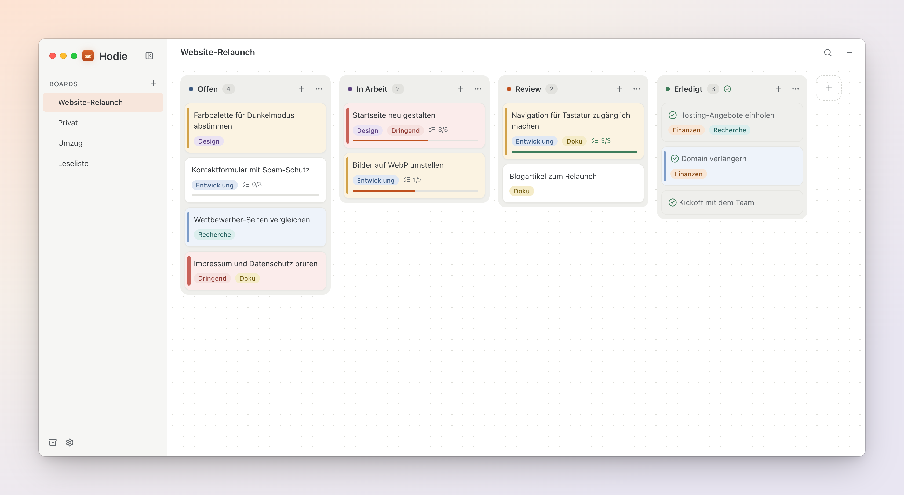
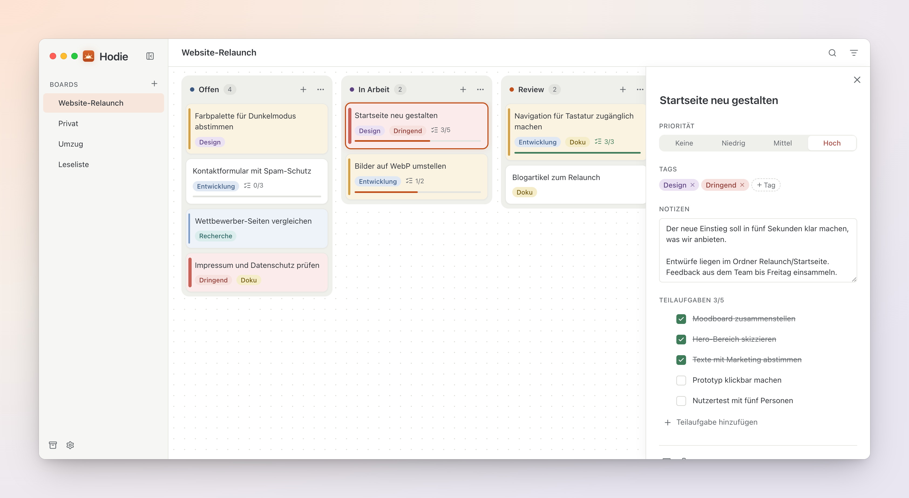
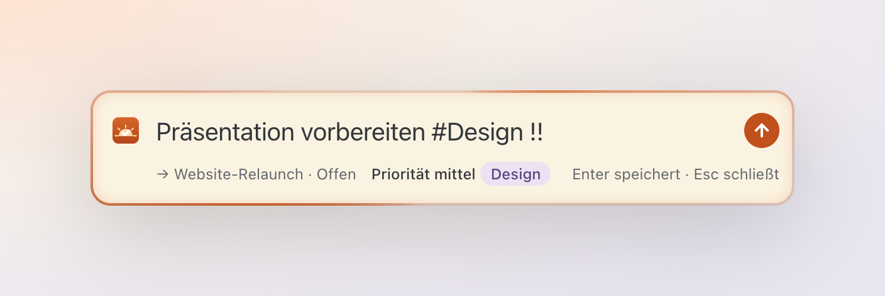
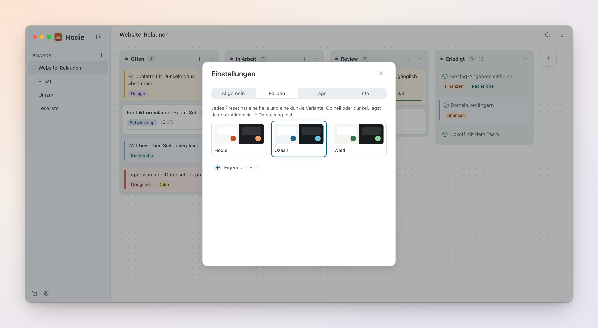

<div align="center">


# Hodie

**Deine Aufgaben als Kanban-Board. Lokal, schnell und ohne Ballast.**

*Hodie* ist Latein und bedeutet „heute“.

[](https://github.com/FynnKaemmerling/Hodie/actions/workflows/build.yml)


<br>

<picture>
  <source media="(prefers-color-scheme: dark)" srcset="docs/screenshots/board-dark.png">
  
</picture>

</div>

## Was Hodie ist

Hodie ist eine Desktop-App für To-dos, und nur dafür. Kein Kalender, kein Chat, kein Wiki drumherum. Aufgaben liegen als Karten in Spalten, man zieht sie dorthin, wo sie hingehören, und alles lässt sich direkt am Board bearbeiten.

- **Lokal und privat:** Alle Daten bleiben auf deinem Rechner. Kein Konto, kein Internet nötig.
- **Deine Dateien:** Boards liegen als lesbare Markdown- und JSON-Dateien in einem Ordner deiner Wahl.
- **Schnell:** Aufgaben per globalem Tastenkürzel von überall erfassen, ohne die App zu öffnen.
- **Komplett per Tastatur bedienbar,** auch das Verschieben von Karten.
- **Plattformübergreifend:** Ein Programm für Windows, macOS und Linux.
- **Mehrsprachig:** Deutsch und Englisch, umschaltbar ohne Neustart.

## Funktionen

### Karten mit allem, was eine Aufgabe braucht

Notizen, Teilaufgaben mit Fortschrittsbalken, vier Prioritätsstufen und farbige Tags. Die Details öffnen sich in einem Seitenpanel, das Board bleibt dabei sichtbar. Gespeichert wird sofort, einen Speichern-Knopf gibt es nicht.

<picture>
  <source media="(prefers-color-scheme: dark)" srcset="docs/screenshots/card-dark.png">
  
</picture>

### Schnelleingabe von überall

Ein systemweites Tastenkürzel (Standard: `Mod+Umschalt+Leertaste`) öffnet ein kleines Eingabefeld über allen Fenstern. Mit einer Kurzschreibweise landen Tags und Priorität direkt mit auf der Karte:

| Eingabe | Wirkung |
|---|---|
| `#design` | vergibt den Tag „design“ und legt ihn bei Bedarf an |
| `!` · `!!` · `!!!` | Priorität niedrig · mittel · hoch |

<p align="center">
  
</p>

### Hell, dunkel und in deinen Farben

Hodie folgt der Systemeinstellung oder bleibt fest hell bzw. dunkel. Neben dem Standard gibt es die Farb-Presets „Ozean“ und „Wald“, eigene lassen sich aus Akzentfarbe und Grundton anlegen. Zu schwache Kontraste zeigt die App direkt am Preset an.



### Außerdem

- Mehrere Boards mit frei benennbaren Spalten (Standard: Offen, In Arbeit, Erledigt)
- Drag & Drop für Karten, Spalten und Boards, alternativ komplett per Tastatur
- Volltextsuche über Titel und Notizen, Filter nach Tag und Priorität
- Archiv für erledigte Karten, auf Wunsch alle auf einmal
- Rückgängig statt Nachfrage: Gelöschtes lässt sich kurz wiederherstellen (`Mod+Z`)
- Barrierefrei: Screenreader-Beschriftungen und Kontraste nach WCAG AA in beiden Themes

## Der Vault: deine Boards als Dateien

Hodie speichert alles in einem gewöhnlichen Ordner, ähnlich wie Obsidian. Jede Karte ist eine eigene Markdown-Datei, jedes Board ein Unterordner:

```
Hodie/
├── .hodie/            Kennung und Tags des Vaults
├── Website-Relaunch/
│   ├── board.json     Name und Spalten
│   └── cards/
│       ├── 01JB7Q4ZK3M8X2V5T9R6N0PWYH.md
│       └── …
└── Privat/
```

```markdown
---
title: "Startseite neu gestalten"
priority: high
subtasks:
  - title: "Moodboard zusammenstellen"
    done: true
---
Der neue Einstieg soll in fünf Sekunden klar machen, was wir anbieten.
```

Damit lässt sich ein Vault über Dropbox, iCloud Drive, OneDrive, Syncthing oder Git mit anderen teilen. Änderungen von außen erscheinen sofort in der App. Bearbeiten zwei Personen gleichzeitig dieselbe Karte, erkennt Hodie die Konfliktkopie des Sync-Dienstes und bietet beide Fassungen zur Auswahl an. Das vollständige Format steht in [`VAULT.md`](VAULT.md).

## Tastenkürzel

| Kürzel | Aktion |
|---|---|
| `Mod+Umschalt+Leertaste` | Schnelleingabe (systemweit, änderbar) |
| `Mod+N` | Neue Karte in der fokussierten Spalte |
| `Mod+F` | Suche |
| `Mod+B` | Seitenleiste ein- und ausblenden |
| `Enter` | Kartendetails öffnen |
| `F2` | Umbenennen |
| `Entf` | Löschen |
| `Mod+Z` | Rückgängig |
| `Esc` | Panel bzw. Eingabe schließen |

`Mod` ist `Cmd` unter macOS und `Strg` unter Windows und Linux.

## Installation

Fertige Installer für alle drei Systeme baut GitHub Actions bei jedem Push auf `main`. Sie liegen als Artefakte am jeweiligen [Workflow-Lauf](https://github.com/FynnKaemmerling/Hodie/actions/workflows/build.yml).

| System | Paket |
|---|---|
| Windows | Installer als `.msi` oder `.exe` |
| macOS | `.app` in einer `.dmg` |
| Linux | `.AppImage`, `.deb`, `.rpm` |

## Selbst bauen

**Voraussetzungen:** [Node.js](https://nodejs.org) (LTS), [Rust](https://rustup.rs) und die [Tauri-Voraussetzungen](https://tauri.app/start/prerequisites/) für dein Betriebssystem.

```sh
npm install              # Abhängigkeiten installieren
npm run tauri dev        # App im Entwicklungsmodus starten
npm run tauri build      # Programm und Installer für das eigene System bauen
npm test                 # Frontend-Tests
cd src-tauri && cargo test   # Backend-Tests
```

## Technik

| Bereich | Technik |
|---|---|
| App-Gerüst | [Tauri 2](https://tauri.app) |
| Backend | Rust |
| Oberfläche | React, TypeScript, Vite, [React Aria](https://react-spectrum.adobe.com/react-aria/) |
| Drag & Drop | [dnd kit](https://dndkit.com) |
| Speicher | Vault-Ordner mit Markdown- und JSON-Dateien, SQLite für Einstellungen |
| Mehrsprachigkeit | i18next |

Tauri nutzt den Browser-Baustein des Betriebssystems statt eines mitgelieferten Chromium. Dadurch bleibt Hodie klein und sparsam.

## Ausblick

Der Umfang des MVP ist bewusst schmal gehalten ([`MVP.md`](MVP.md)). Denkbar für später:

- Fälligkeitsdaten und Erinnerungen
- Wiederkehrende Aufgaben
- Import, Export und Backups
- Eigene Synchronisation ohne fremden Sync-Dienst

## Mitarbeit

Designrichtung und Gestaltungsregeln stehen in [`DESIGN.md`](DESIGN.md), Konventionen und Architektur in [`CLAUDE.md`](CLAUDE.md).

## Lizenz

Noch nicht festgelegt.
